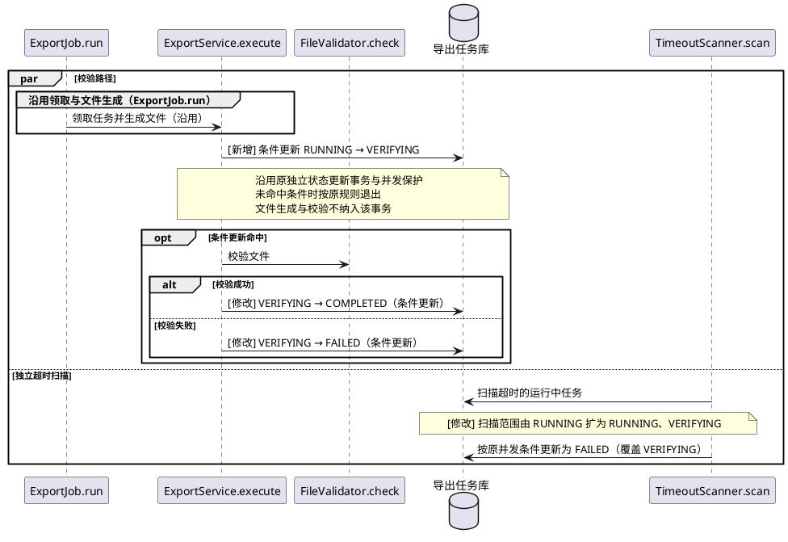

# mark-verifying — 标记校验阶段

## 数据模型

- 结构变更：无

本期不涉及数据模型变更，沿用现有实现。

示例中的 export_tasks.phase 为无数据库枚举或 CHECK 约束的字符串字段，VERIFYING 仅新增业务值，无 SQL 调整；实际项目必须核对字段约束，不能照搬此结论。

## 功能时序图

- 时序图：生成

## 接口设计

本期不涉及接口变更，沿用现有实现。

## 代码改造点

- `src/ExportPhase.java`：增加内部校验中状态值。
- `src/ExportService.java`：在既有校验前记录校验中状态，并调整完成条件。
- `src/TimeoutScanner.java`：把校验中状态纳入原运行中超时处理范围。
