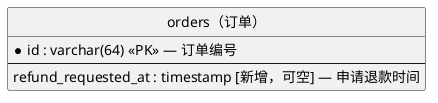
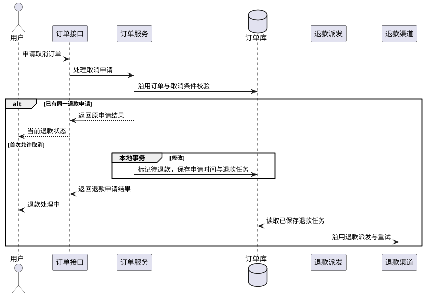

# cancel-order — 发起取消

## 数据模型

- 结构变更：新增字段

旧订单的新增字段保留 NULL，不回填。以下为 PostgreSQL 示例，实际计划须替换为项目数据库方言及迁移约定。

### 订单域



```sql
ALTER TABLE orders ADD COLUMN refund_requested_at TIMESTAMP NULL;
```

先执行字段迁移再上线应用。恢复旧应用前停止新取消入口并核对在途退款；恢复时保留新增列和已写数据，确认在途退款处理完成后再评估清理，不自动删除列。

## 功能时序图

- 时序图：生成



- 事务内按 `PAID` 条件更新为 `REFUND_PENDING`，记录 `refund_requested_at` 并写入退款任务；任一失败全部回滚，提交后才返回成功。
- 派发与重试复用同一退款请求 ID；已有查询、归属和渠道校验规则沿用 `OrderService.cancel`。

## 接口设计

### POST `/orders/{id}/cancel`

入参沿用：路径 id（String），请求头 Idempotency-Key（String），无请求体。

失败响应：无权操作返回 403，不满足取消条件返回 409。

出参（202，仅列变更）：

| 字段 | 类型 | 变更 |
| --- | --- | --- |
| status | String | 修改：新增枚举 REFUND_PENDING |
| refundRequestId | String | 新增：退款请求 ID |

响应 JSON（变更字段示例）：

```json
{"status": "REFUND_PENDING", "refundRequestId": "refund-123"}
```

## 代码改造点

- `src/main/java/example/OrderService.java`：将直接取消改为事务内记录待退款、申请时间及退款任务。
- `src/main/java/example/Order.java`：映射新增的退款申请时间。
- `src/main/resources/db/migration/V42__refund_requested_at.sql`：新增订单退款申请时间列迁移。
