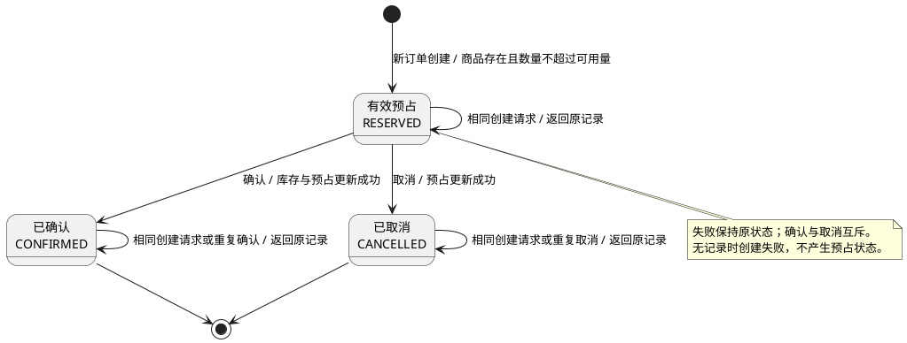

# 库存预占生命周期

## 业务目标与步骤

按订单预留商品库存，再由确认扣减或取消释放结束预占。一个订单只有一条预占记录；终态不会重新开启。

1. 创建：新订单数量不超过可用量时进入 `RESERVED`，账面库存不变。
2. 确认：`RESERVED` 进入 `CONFIRMED`，账面库存扣减预占数量。
3. 取消：`RESERVED` 进入 `CANCELLED`，账面库存不变，释放预占数量。

预占量只汇总 `RESERVED`；可用量 = 账面库存 − 预占量。确认后可用量不变，取消后可用量增加预占数量（`inventory/service.py:14`）。

## 入口目录

HTTP 入口符号均为 `inventory/http.py` 的 `make_handler` 所生成的 `Handler` 方法。业务入口负责规则判断和状态变更。

| 步骤 | 触发类型与入口 | 仓库相对路径、入口符号 | 业务入口与说明 |
| --- | --- | --- | --- |
| 创建 | HTTP `POST /reservations` | `inventory/http.py:24`，`Handler.do_POST` | `inventory.service.reserve_stock`；JSON 对象包含 `order_id`、`sku`、`quantity` |
| 确认 | HTTP `POST /reservations/{order_id}/confirm` | `inventory/http.py:36`，`Handler.do_POST` | `inventory.service.confirm_reservation`；订单为一个 URL 编码路径段，无请求体 |
| 取消 | HTTP `POST /reservations/{order_id}/cancel` | `inventory/http.py:36`，`Handler.do_POST` | `inventory.service.cancel_reservation`；订单为一个 URL 编码路径段，无请求体 |
| 查看库存 | HTTP `GET /inventory/{sku}` | `inventory/http.py:12`，`Handler.do_GET` | `inventory.service.get_inventory`；只读取库存，不推进生命周期 |

没有 RPC、消息、定时任务、回调或异步推进点。三种写操作在事务提交后同步返回预占记录；没有过期释放或后台补偿。

## 当前状态机

状态字段为 `reservations.status`；允许值由 `inventory/migrations/002_reservations.sql:5` 约束。

| 名称/值 | 含义 | 初态/终态 |
| --- | --- | --- |
| `RESERVED` | 有效预占，数量占用可用库存 | 创建后的初态 |
| `CONFIRMED` | 已确认，账面库存已扣减 | 终态 |
| `CANCELLED` | 已取消，不再占用可用库存 | 终态 |

## 状态流转表

所有触发均为同步 HTTP 请求。下表分别列出业务入口和实际写状态的位置；“无”表示不执行状态写入。

| 源 → 目标 | 触发事件与前置条件 | 业务入口符号 | 实际状态变更符号、证据路径 |
| --- | --- | --- | --- |
| 无记录 → `RESERVED` | 创建；订单和商品标识为非空白字符串，数量为 1 至 9223372036854775807 的整数；订单不存在、商品存在，数量 ≤ 可用量 | `inventory.service.reserve_stock` | `reserve_stock` 的 INSERT；`inventory/service.py:65`、`:79`、`:88` |
| `RESERVED` → `CONFIRMED` | 确认；商品扣减与预占条件更新各影响一行 | `inventory.service.confirm_reservation` | `confirm_reservation` 的库存 UPDATE 和状态 UPDATE；`inventory/service.py:96`、`:103`、`:109` |
| `RESERVED` → `CANCELLED` | 取消；预占条件更新影响一行 | `inventory.service.cancel_reservation` | `cancel_reservation` 的状态 UPDATE；`inventory/service.py:119`、`:126` |
| 各现有状态 → 原状态 | 重试创建；同一订单的商品和数量完全相同，包括两个终态 | `inventory.service.reserve_stock` | 无；直接返回已有记录，`inventory/service.py:71` |
| `CONFIRMED` → `CONFIRMED` | 重复确认 | `inventory.service.confirm_reservation` | 无；跳过写入并返回已有记录，`inventory/service.py:99`、`:102`、`:116` |
| `CANCELLED` → `CANCELLED` | 重复取消 | `inventory.service.cancel_reservation` | 无；跳过写入并返回已有记录，`inventory/service.py:122`、`:125`、`:133` |
| 无记录或现有状态 → 不变 | 参数无效 400；商品/预占不存在 404；创建参数与同订单冲突、库存不足或跨终态操作 409 | 上述三个业务入口；HTTP 输入错误由 `Handler.do_POST` 拒绝 | 无；`inventory/http.py:27`；`inventory/service.py:51`、`:56`、`:65`、`:100`、`:123` |
| `RESERVED` → `RESERVED` | 确认库存扣减/状态更新失败，或取消状态更新未影响一行，返回 409 | `inventory.service.confirm_reservation`、`inventory.service.cancel_reservation` | `_write_transaction` 回滚；`inventory/service.py:40`、`:107`、`:113`、`:130` |
| 无记录或现有状态 → 不变 | 数据库忙/锁定返回 503，可由调用方重试；其他数据库错误返回 500 | 上述三个业务入口 | `_write_transaction` 回滚或未开始写入；`inventory/service.py:32`、`:40`；锁等待配置 `inventory/db.py:7` |

`_write_transaction` 先执行 `BEGIN IMMEDIATE`，成功提交、异常回滚（`inventory/service.py:40`）。确认同时更新账面库存与预占状态，不会只提交一部分；取消无需修改商品库存。并发确认和取消只能进入一个终态，后到的相反操作返回 409。失败不创建额外的失败状态，也不触发自动重试或补偿。

## 持久化与证据

预占记录按 `order_id` 主键保存；终态记录保留，不删除（`inventory/migrations/002_reservations.sql:1`）。服务重启执行保留现有表的迁移，已有预占和库存仍在（`inventory/db.py:13`）。

对应行为测试：`tests/test_reservations.py:89`（确认）、`:101`（取消及不重开）、`:137`（重复创建）、`:149`（终态竞争）、`:168`（重启）、`:196`（失败回滚）。本索引按实现提交 `54433356b72081445ef6b0d82804d37a38ae1ffe` 核对。
