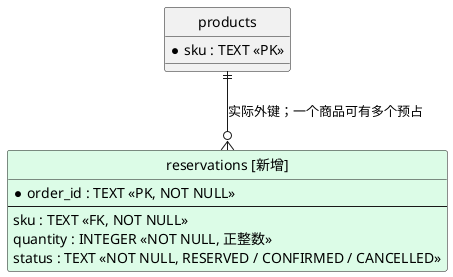
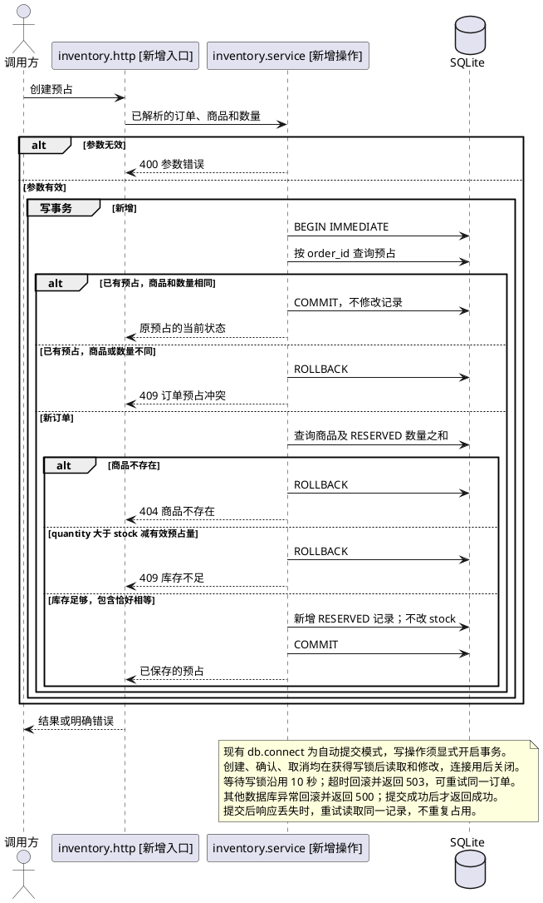

# reserve-stock — 创建预占

## 数据模型

- 结构变更：新增表
- SQL迁移：需要



```sql
CREATE TABLE IF NOT EXISTS reservations (
    order_id TEXT PRIMARY KEY NOT NULL,
    sku TEXT NOT NULL REFERENCES products(sku),
    quantity INTEGER NOT NULL CHECK (typeof(quantity) = 'integer' AND quantity > 0),
    status TEXT NOT NULL CHECK (status IN ('RESERVED', 'CONFIRMED', 'CANCELLED'))
);
CREATE INDEX IF NOT EXISTS idx_reservations_sku_status ON reservations(sku, status);
```

初始化在现有迁移后执行新增迁移，保留原商品数据；新表初始为空。回退应用时先停用预占写入口并处理有效预占，保留新表和已写数据。

## 功能时序图

- 时序图：生成



写锁选择依据：[SQLite 事务说明](https://www.sqlite.org/lang_transaction.html)。库存查询使用单条汇总查询，同时取 `stock` 和仅 `RESERVED` 的数量之和，保证三个数字来自同一快照。

## 接口设计

### POST `/reservations`

请求体必须是 JSON 对象；标识按原字符串匹配，不自动去空格或改大小写。

| 字段 | 类型 | 必填 | 说明 |
| --- | --- | --- | --- |
| order_id | String | 是 | 非空白订单标识，同时作为唯一预占标识 |
| sku | String | 是 | 非空白商品标识 |
| quantity | Integer | 是 | 1 至 9223372036854775807；拒绝布尔值、小数和数字字符串 |

成功均返回 200，下表是三个写接口共用的完整预占响应。

| 字段 | 类型 | 必填 | 说明 |
| --- | --- | --- | --- |
| order_id | String | 是 | 原订单标识 |
| sku | String | 是 | 原商品标识 |
| quantity | Integer | 是 | 原预占数量 |
| status | String | 是 | 当前状态：RESERVED、CONFIRMED 或 CANCELLED |

响应 JSON 示例：

```json
{"order_id":"order-001","sku":"DEMO","quantity":2,"status":"RESERVED"}
```

同一订单、商品和数量重试返回同一记录及当前状态，终态记录也保留；不重新激活。商品或数量不同始终返回冲突，先于商品存在性和剩余库存判断。

三个写接口共用错误响应 `{"error":"原因"}`。格式错误、缺字段或类型/范围错误返回 400；未知商品返回 404；订单冲突或库存不足返回 409。写锁等待超时返回 503，其他数据库异常返回 500；失败不改变库存。

### GET `/inventory/{sku}`

沿用现有商品查询和未知商品的 404；无请求体。成功仍返回 200，保留原字段，仅新增：

| 字段 | 类型 | 必填 | 说明 |
| --- | --- | --- | --- |
| reserved | Integer | 是 | 仅 RESERVED 记录的数量之和；没有记录时为 0 |
| available | Integer | 是 | stock 减 reserved |

响应 JSON（新增字段局部示例）：

```json
{"reserved":2,"available":8}
```

## 代码改造点

- `inventory/migrations/002_reservations.sql`：新增预占表、订单唯一约束和商品状态索引。
- `inventory/db.py`：初始化加载新增迁移，沿用文件数据库和外键约束。
- `inventory/service.py`：实现创建预占、显式事务和公共错误规则，库存查询增加有效预占量与可用量。
- `inventory/http.py`：增加创建预占入口、JSON 参数解析和错误响应。
