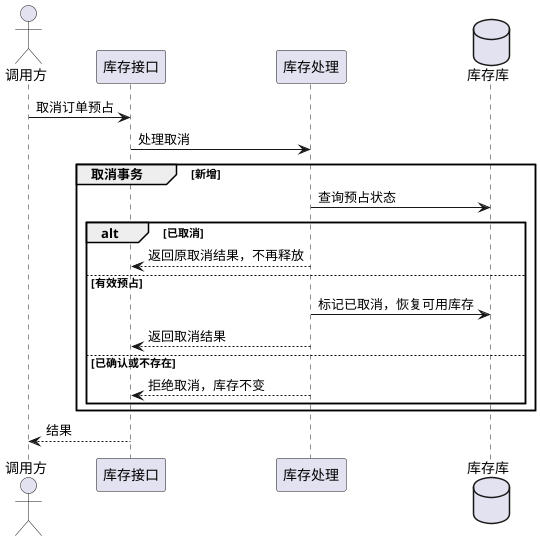

# cancel-reservation — 取消释放

## 数据模型

- 结构变更：无
- 引用：[reserve-stock](reserve-stock.md#数据模型)

## 功能时序图

- 时序图：生成

- 沿用[创建预占的写事务约束](reserve-stock.md#功能时序图)。只将 `RESERVED` 条件更新为 `CANCELLED`，不改 `stock`；状态更新须命中一行，失败回滚并返回冲突。
- 有效预占量只统计 `RESERVED`，取消后可用量自然恢复；确认和取消按获得写锁后的状态判断，终态不互换。

## 接口设计

- 引用：[reserve-stock](reserve-stock.md#接口设计)

### POST `/reservations/{order_id}/cancel`

| 字段 | 类型 | 必填 | 说明 |
| --- | --- | --- | --- |
| order_id（路径） | String | 是 | 原订单标识，作为一个 URL 编码的路径段 |

无请求体。成功返回 200 和共享预占响应，`status` 为 `CANCELLED`；重复取消相同。未知预占返回 404，已确认返回 409；错误体及数据库异常沿用共享契约。

## 代码改造点

- `inventory/service.py`：在写事务内取消有效预占，按状态拒绝取消已确认记录。
- `inventory/http.py`：增加取消入口，解析订单路径并返回业务结果。
