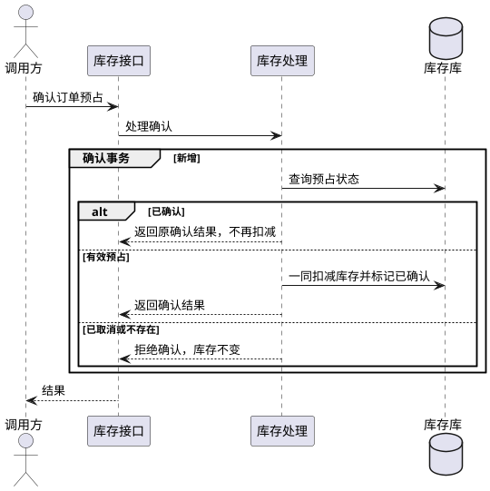

# confirm-reservation — 确认扣减

## 数据模型

- 结构变更：无
- 引用：[reserve-stock](reserve-stock.md#数据模型)

## 功能时序图

- 时序图：生成

- 沿用[创建预占的写事务约束](reserve-stock.md#功能时序图)。扣减仅在 `stock >= quantity` 时执行，扣减和状态条件更新各须命中一行；任何失败全部回滚，按下文契约返回库存数据不一致。
- 与取消并发时，以获得写锁后的状态判断，只能成功进入一种终态。确认后账面量和预占量同减，可用量不变。

## 接口设计

- 引用：[reserve-stock](reserve-stock.md#接口设计)

### POST `/reservations/{order_id}/confirm`

| 字段 | 类型 | 必填 | 说明 |
| --- | --- | --- | --- |
| order_id（路径） | String | 是 | 原订单标识，作为一个 URL 编码的路径段 |

无请求体。成功返回 200 和共享预占响应，`status` 为 `CONFIRMED`；重复确认相同。未知预占返回 404，已取消或库存数据不一致返回 409；错误体及数据库异常沿用共享契约。

## 代码改造点

- `inventory/service.py`：在同一写事务内扣减账面库存并确认预占，按状态处理重复与冲突。
- `inventory/http.py`：增加确认入口，解析订单路径并返回业务结果。
