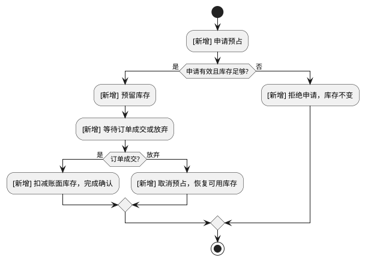
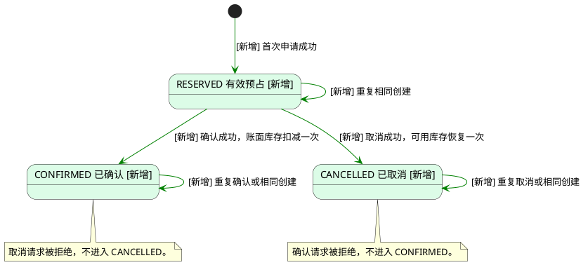

# 库存预占服务

- 业务流程变化：有
- 判定依据：现状仅能查询库存，没有预留、成交扣减或取消释放阶段（inventory/http.py、inventory/service.py）。目标新增从预占申请到预留库存，再到确认成交或取消释放的生命周期，业务阶段和结果均有变化；规则来自 requirements.md，现状与 .keel/eval/research.md 一致。

## 背景

- User Story：作为下单方，我希望先预留足够的库存，以便多个订单同时申请时不会超卖。
- User Story：作为下单方，我希望成交时扣减库存、放弃时释放库存，以便库存反映订单的实际结果。

## 业务流程总览

### 库存预占生命周期

## 状态机

### 预占状态机

